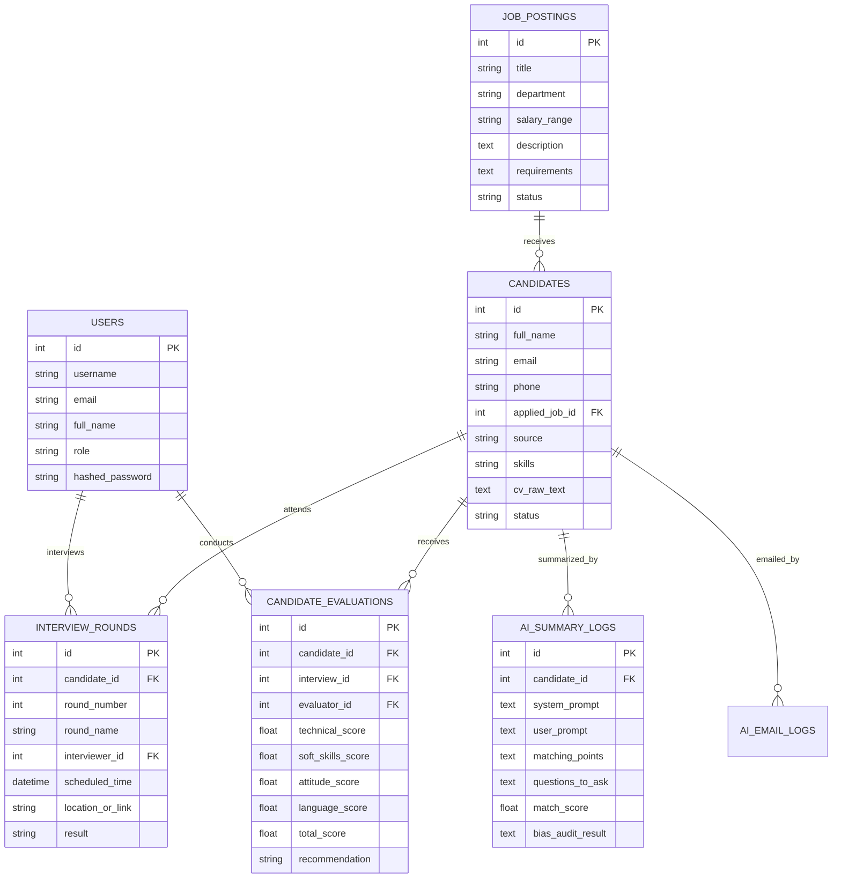

# BÁO CÁO GIAI ĐOẠN KT1: PHÂN TÍCH QUY TRÌNH TUYỂN DỤNG, ACTOR, ERD VÀ RỦI RO THIÊN LỆCH

**Học phần:** Ứng dụng Trí tuệ Nhân tạo - AIA331  
**Mã dự án:** 80297  
**Tên đề tài:** Hệ thống quản lý tuyển dụng có tích hợp AI  
**Đơn vị:** Trường Đại học Công nghệ Thông tin và Truyền thông - Đại học Thái Nguyên  

---

## 1. PHÂN TÍCH QUY TRÌNH TUYỂN DỤNG VÀ CÁC TÁC NHÂN (ACTORS)

### 1.1. Các tác nhân trong hệ thống (Actors)
1. **Quản trị viên (Admin):**
   - Quản trị toàn bộ hệ thống người dùng (tạo tài khoản, phân quyền).
   - Thiết lập cấu hình hệ thống, AI Engine API keys (Gemini, OpenAI, Fallback).
   - Giám sát toàn bộ dữ liệu tuyển dụng và log phân tích của AI.
2. **Chuyên viên nhân sự (HR Specialist / HR Lead):**
   - Khởi tạo và quản lý các vị trí tuyển dụng (Job Postings).
   - Tiếp nhận hồ sơ ứng viên (thông qua upload CV hoặc nhập liệu).
   - Sử dụng AI để tóm tắt nhanh CV so với bản mô tả công việc (JD).
   - Lên lịch phỏng vấn, chỉ định người phỏng vấn.
   - Sử dụng AI sinh các mẫu email mời phỏng vấn, thư từ chối hoặc Job Offer.
   - Theo dõi pipeline trạng thái tuyển dụng và xem báo cáo thống kê.
3. **Người phỏng vấn / Trưởng bộ phận chuyên môn (Interviewer / Tech Lead):**
   - Xem thông tin ứng viên và bản tóm tắt hồ sơ do AI thực hiện.
   - Nhận bộ câu hỏi gợi ý từ AI theo đúng kỹ năng cần đánh giá.
   - Thực hiện phỏng vấn và nhập phiếu đánh giá theo 4 nhóm tiêu chí: Chuyên môn kỹ thuật (40%), Kỹ năng mềm (25%), Thái độ (25%), Ngoại ngữ (10%).
   - Đưa ra quyết định khuyến nghị: Tuyển dụng (HIRE), Cân nhắc (CONSIDER) hoặc Từ chối (REJECT).

### 1.2. Quy trình tuyển dụng khép kín (Recruitment Pipeline)
```
[1. Ứng tuyển (APPLIED)]
          │
          ▼
[2. Sơ loại hồ sơ (SCREENING)] ──► AI hỗ trợ tóm tắt CV theo JD & kiểm duyệt thiên lệch
          │
          ▼
[3. Phỏng vấn (INTERVIEW)] ──────► AI gợi ý câu hỏi chuyên môn & tình huống STAR
          │
          ▼
[4. Đánh giá (EVALUATION)] ──────► Con người (Interviewer) chấm điểm và ra quyết định
          │
          ├────────────────────────┬────────────────────────┐
          ▼                        ▼                        ▼
[5. Đề nghị (OFFERED)]    [6. Từ chối (REJECTED)]   [Cân nhắc thêm (CONSIDER)]
          │                        ▲
          ▼                        │
[7. Nhận việc (HIRED)]     AI sinh thư từ chối
          ▲
          │
AI sinh Job Offer
```

---

## 2. THIẾT KẾ MÔ HÌNH DỮ LIỆU THỰC THỂ (ERD)



---

## 3. MA TRẬN PHÂN TÍCH RỦI RO THIÊN LỆCH (BIAS RISK MATRIX)

Khi ứng dụng AI vào tuyển dụng, rủi ro lớn nhất là AI học lại các thiên kiến xã hội từ dữ liệu huấn luyện hoặc diễn giải sai lệch thông tin cá nhân. Bảng phân tích rủi ro và giải pháp kiểm soát được thiết lập như sau:

| Mã rủi ro | Loại thiên lệch | Mô tả biểu hiện rủi ro | Mức độ rủi ro | Cơ chế kiểm soát & Phòng chống trong hệ thống |
|:---:|:---|:---|:---:|:---|
| **R1** | **Thiên lệch Giới tính (Gender Bias)** | Đánh giá thấp ứng viên nữ cho các vị trí kỹ thuật / lập trình backend. | **Cao** | • Prompt cô lập: cấm suy diễn giới tính.<br>• Bộ lọc Anti-bias phát hiện từ khóa giới tính và cảnh báo.<br>• Đánh giá dựa trên danh mục kỹ năng thực tế. |
| **R2** | **Thiên lệch Độ tuổi (Ageism)** | Xu hướng ưu tiên người trẻ, định kiến người lớn tuổi khó thích nghi công nghệ mới. | **Trung bình** | • Không dùng độ tuổi làm tiêu chí tính điểm tương thích.<br>• Phân tích dựa trên số năm kinh nghiệm và sản phẩm dự án. |
| **R3** | **Thiên lệch Địa lý / Quê quán** | Phân biệt đối xử dựa trên quê quán, hộ khẩu hoặc tôn giáo của ứng viên. | **Cao** | • Loại trừ hoàn toàn trường địa chỉ thường trú khỏi Prompt gửi vào mô hình AI. |
| **R4** | **Quyền lực thuật toán (Algorithmic Determinism)** | Phụ thuộc hoàn toàn vào điểm số AI để tự động loại bỏ hồ sơ ứng viên (Ghost rejection). | **Nghiêm trọng** | • **Nguyên tắc bắt buộc Human-in-the-loop**:<br>AI chỉ đưa ra tóm tắt gợi ý, nút bấm chuyển trạng thái Đạt/Trượt hoàn toàn do con người thao tác. |

---
*Báo cáo được hoàn thiện làm tài liệu minh chứng cho bài kiểm tra định kỳ KT1.*
